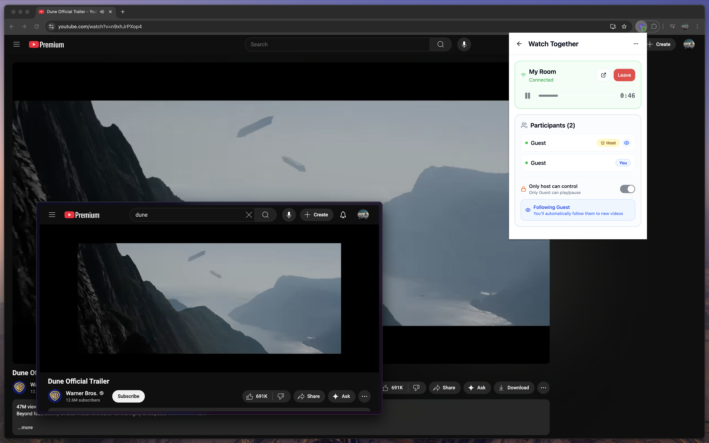

# Watch Together

Sync video across the web with friends. Watch on any site, stay in perfect sync.

## How it works

- The browser extension finds the main video on the page, in any frame.
- A Cloudflare Durable Object owns each room. Members send what they did, and the room sends everyone its state.
- Followers' tabs go wherever the host goes. A share link is the host's video with the room attached.

See [`docs/rewrite-plan.md`](./docs/rewrite-plan.md) for the design.

## Development

Run `pnpm install` to get started.

`pnpm dev` — Start development  
`pnpm build` — Build everything  
`pnpm test` — Run unit tests  
`pnpm test:e2e` — Run the extension end to end in Chromium  
`pnpm lint` — Lint code  
`pnpm typecheck` — Check types

`pnpm extension:dev` — Work on the browser extension  
`pnpm backend:deploy` — Deploy the backend

The codebase is a pnpm monorepo powered by [Turborepo](https://turborepo.com/):

- `apps/extension` — the browser extension (WXT, React, Tailwind)
- `apps/backend` — the room server (Cloudflare Worker + Durable Objects)
- `apps/website` — the website (Next.js)
- `packages/protocol` — the wire protocol shared by both ends
- `packages/logo` — the logo and icons
